# Easy Order Manager (EOM) — Complete Feature Documentation

> **Purpose**: This document is the definitive feature specification for the Easy Order Manager WordPress/WooCommerce plugin. It maps every feature, logic flow, data structure, and business rule so that **any coding agent** can use it as a blueprint to rebuild these capabilities into a standalone SaaS web application or Android app.

---

## Table of Contents

1. [System Architecture Overview](#1-system-architecture-overview)
2. [Database Schema](#2-database-schema)
3. [User Roles & Permissions](#3-user-roles--permissions)
4. [PAGE: Dashboard (Order Management Hub)](#4-page-dashboard-order-management-hub)
5. [PAGE: Inventory Management](#5-page-inventory-management)
6. [PAGE: Profit & Loss Analytics](#6-page-profit--loss-analytics)
7. [PAGE: Customer Stats & Fraud Detection](#7-page-customer-stats--fraud-detection)
8. [PAGE: Courier Management & Settings](#8-page-courier-management--settings)
9. [PAGE: Team Management](#9-page-team-management)
10. [PAGE: Delivery Charge Alerts](#10-page-delivery-charge-alerts)
11. [FEATURE: Invoice Generation & Printing](#11-feature-invoice-generation--printing)
12. [FEATURE: Customer Order Tracking (Frontend)](#12-feature-customer-order-tracking-frontend)
13. [FEATURE: Google Sheets Integration](#13-feature-google-sheets-integration)
14. [FEATURE: Return Minimizer Automation](#14-feature-return-minimizer-automation)
15. [FEATURE: Urgent Order Monitoring](#15-feature-urgent-order-monitoring)
16. [FEATURE: Customer Blocking](#16-feature-customer-blocking)
17. [FEATURE: Steadfast XLSX Import](#17-feature-steadfast-xlsx-import)
18. [FEATURE: CSV Export](#18-feature-csv-export)
19. [Settings & Configuration](#19-settings--configuration)
20. [Master Flowcharts](#20-master-flowcharts)

---

## 1. System Architecture Overview

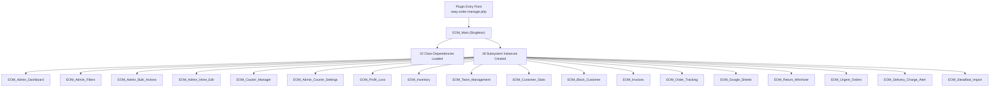

### Navigation Menu Structure

| Menu Item | Page Slug | Handler |
|---|---|---|
| **EOM Orders** (Main) | `eom-dashboard` | Dashboard page |
| ↳ Dashboard | `eom-dashboard` | Order management table + all actions |
| ↳ Inventory | `eom-inventory` | Stock & cost management |
| ↳ Profit & Loss | `eom-profit-loss` | Financial analytics |
| ↳ Team Management | `eom-team` | Staff roles & assignment |
| ↳ Activity Log | `eom-activity-log` | Audit trail |
| ↳ Charge Alerts | `eom-charge-alerts` | Delivery charge discrepancies |
| ↳ Courier Settings | `eom-courier-settings` | API keys & courier config |
| ↳ Blocked Customers | `eom-blocked-customers` | Customer blocklist |

### Custom Order Statuses Registered

| Status Slug | Label |
|---|---|
| `wc-eom-awaiting-shipment` | Awaiting Shipment |
| `wc-eom-return-requested` | Return Requested |

### Scheduled Cron Jobs

| Hook | Frequency | Purpose |
|---|---|---|
| `eom_daily_urgent_check` | Daily | Detect stalled courier shipments |
| `eom_daily_charge_check` | Daily | Audit courier charge discrepancies |
| `eom_weekly_inventory_check` | Weekly | Check for low-stock products |

---

## 2. Database Schema

Four custom database tables are created on plugin activation:

### `eom_courier_bookings`
Tracks every courier dispatch.

| Column | Type | Description |
|---|---|---|
| `id` | BIGINT AUTO_INCREMENT PK | Row ID |
| `order_id` | BIGINT | WooCommerce order ID |
| `courier_slug` | VARCHAR(50) | e.g., `steadfast`, `pathao`, `redx` |
| `tracking_id` | VARCHAR(100) | Courier tracking number |
| `consignment_id` | VARCHAR(100) | Courier consignment/parcel ID |
| `status` | VARCHAR(50) | Current delivery status |
| `charge` | DECIMAL(10,2) | Delivery charge amount |
| `created_at` | DATETIME | Booking timestamp |
| `updated_at` | DATETIME | Last status update |

### `eom_charge_discrepancies`
Audits courier charge overcharges/undercharges.

| Column | Type | Description |
|---|---|---|
| `id` | BIGINT AUTO_INCREMENT PK | Row ID |
| `order_id` | BIGINT | WooCommerce order ID |
| `courier` | VARCHAR(50) | Courier slug |
| `expected` | DECIMAL(10,2) | Calculated expected charge |
| `actual` | DECIMAL(10,2) | Actual charge from courier |
| `difference` | DECIMAL(10,2) | `actual - expected` |
| `status` | VARCHAR(20) | `open` or `reviewed` |
| `created_at` | DATETIME | Record timestamp |

### `eom_activity_log`
Complete audit trail of all user actions.

| Column | Type | Description |
|---|---|---|
| `id` | BIGINT AUTO_INCREMENT PK | Row ID |
| `user_id` | BIGINT | WordPress user ID |
| `action` | VARCHAR(255) | Action description |
| `order_id` | BIGINT | Related order (nullable) |
| `details` | TEXT | JSON/text detail blob |
| `created_at` | DATETIME | Action timestamp |

### `eom_inventory_log`
Tracks all stock movements.

| Column | Type | Description |
|---|---|---|
| `id` | BIGINT AUTO_INCREMENT PK | Row ID |
| `product_id` | BIGINT | WooCommerce product ID |
| `quantity` | INT | Change amount (+/-) |
| `type` | VARCHAR(50) | `auto_deduction`, `manual_adjustment` |
| `created_at` | DATETIME | Movement timestamp |

### Key Order Metadata (per-order)

| Meta Key | Type | Description |
|---|---|---|
| `eom_courier_name` | string | Assigned courier slug |
| `eom_tracking_id` | string | Tracking number |
| `eom_consignment_id` | string | Consignment ID |
| `eom_courier_status` | string | Generic courier status |
| `eom_steadfast_delivery_status` | string | Steadfast-specific status |
| `eom_courier_charge` | decimal | Delivery charge |
| `eom_courier_cod_fee` | decimal | COD collection fee |
| `eom_courier_tracking_url` | url | Direct tracking URL |
| `eom_assigned_staff` | int | Staff user ID |
| `eom_steadfast_merchant_id` | string | Which Steadfast merchant account |
| `eom_activity_log` | array | Per-order action log entries |
| `eom_location_review_status` | string | Location verification result |
| `_eom_customer_blocked` | bool | Customer blocked flag |
| `_eom_stock_deducted` | bool | Stock already deducted flag |
| `_eom_product_cost` | decimal | Product cost (per product) |
| `_eom_packaging_cost` | decimal | Packaging cost (per product) |

---

## 3. User Roles & Permissions

### Role: `eom_manager`

| Capability | Granted |
|---|---|
| `manage_woocommerce` | ✅ |
| `read/edit/publish_shop_orders` | ✅ |
| `list_users` | ✅ |
| `eom_manage_team` | ✅ |
| `eom_view_profit` | ✅ |
| `eom_export_data` | ✅ |
| `eom_book_courier` | ✅ |
| `delete_shop_orders` | ❌ |
| See all orders | ✅ |

### Role: `eom_staff`

| Capability | Granted |
|---|---|
| `read/edit_shop_orders` | ✅ |
| `publish_shop_orders` | ❌ |
| `eom_book_courier` | ✅ |
| See all orders | ❌ — **Only sees orders assigned to them** |

### Staff Order Visibility Logic

```
IF user.role == 'eom_staff':
    FILTER all order queries WHERE eom_assigned_staff == current_user_id
ELSE:
    Show all orders (no filter)
```

---

## 4. PAGE: Dashboard (Order Management Hub)

> [!IMPORTANT]
> The Dashboard is the **central command center** of EOM. It contains the most features of any page: a real-time order table, status filtering, bulk actions, inline editing, courier operations, customer fraud checks, invoice printing, Steadfast import, and CSV export — all in one view.

### 4.1 Status Summary Bar

A row of **clickable pill-shaped badges** at the top showing order counts per status.

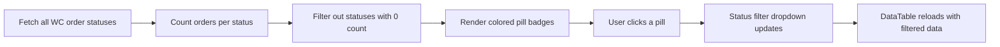

**Status Color Map:**

| Status | Color |
|---|---|
| `pending` | `#f59e0b` (amber) |
| `processing` | `#3b82f6` (blue) |
| `on-hold` | `#8b5cf6` (purple) |
| `completed` | `#10b981` (green) |
| `cancelled` | `#ef4444` (red) |
| `refunded` | `#6b7280` (gray) |
| `failed` | `#dc2626` (dark red) |
| `eom-awaiting-shipment` | `#06b6d4` (cyan) |
| `eom-return-requested` | `#f97316` (orange) |

### 4.2 Advanced Filter System

A comprehensive filter bar allowing multi-criteria order searching.

**Available Filters:**

| Filter | Type | Behavior |
|---|---|---|
| Status | Dropdown | All WC statuses |
| Date From | Date picker | Orders created >= date |
| Date To | Date picker | Orders created <= date + 23:59:59 |
| Product | Select2 (AJAX search) | Searches product names, returns ID |
| Category | Dropdown | Product category taxonomy |
| Courier | Dropdown | Steadfast, RedX, Pathao, Sundarban, eCourier, etc. |
| Assigned Staff | Dropdown | Lists staff who have been assigned orders |
| Payment Method | Dropdown | COD, bKash, etc. |
| Text Search | Text input | Searches: billing first/last name, phone, email. If numeric, searches by Order ID |

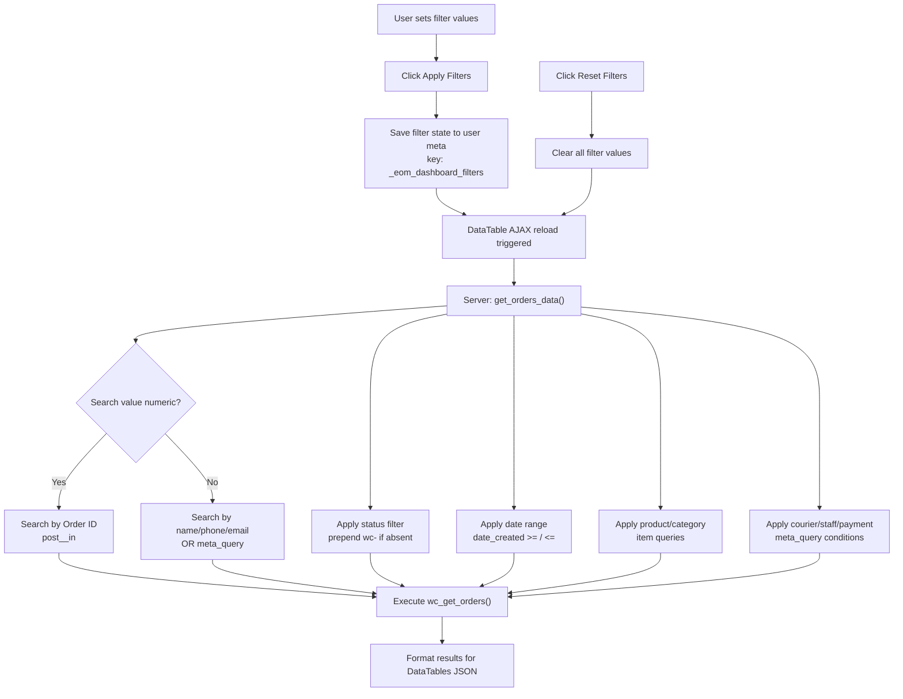

**Filter State Persistence:**
- Filters are saved to current user's meta (`_eom_dashboard_filters`)
- On page load, saved filters are restored
- Reset clears both UI and saved state

### 4.3 Orders DataTable (Server-Side Processing)

The main order list uses **DataTables with server-side processing** for handling large datasets efficiently.

**Table Columns:**

| # | Column | Sortable | Content |
|---|---|---|---|
| 0 | Checkbox | ❌ | Row selection for bulk actions |
| 1 | Order ID | ✅ | Order number with link |
| 2 | Date | ✅ | `Y-m-d H:i` format |
| 3 | Customer Name | ❌ | `billing_first_name + billing_last_name` |
| 4 | Phone | ❌ | `billing_phone` |
| 5 | Email | ❌ | `billing_email` |
| 6 | Products | ❌ | Product names × qty, truncated after 3 items with `...` |
| 7 | Total | ✅ | Order total (formatted) |
| 8 | Payment Method | ❌ | Payment method title |
| 9 | Status | ❌ | Colored badge |
| 10 | Del. Status | ❌ | Steadfast delivery status badge + refresh icon |
| 11 | Courier | ❌ | Courier name from meta |
| 12 | Consignment | ❌ | Consignment ID |
| 13 | Tracking | ❌ | Clickable tracking link |
| 14 | Del. Charge | ❌ | Courier delivery charge |
| 15 | COD Fee | ❌ | Courier COD fee |
| 16 | Staff | ❌ | Assigned staff display name |
| 17 | Actions | ❌ | Action buttons |

**Product Truncation Logic:**
```
products = []
FOR each item in order.items:
    products.append(item.name + " × " + item.quantity)
IF products.length > 3:
    display = products[0:3].join(", ") + "..."
ELSE:
    display = products.join(", ")
```

**Tracking Link Generation:**
```
IF eom_courier_tracking_url exists:
    USE that exact URL
ELSE IF courier == "steadfast":
    URL = "https://steadfast.com.bd/t/" + tracking_id
ELSE IF courier == "pathao":
    URL = "https://merchant.pathao.com/tracking/" + tracking_id
ELSE IF courier == "redx":
    URL = "https://redx.com.bd/track/" + tracking_id
ELSE:
    Display tracking_id as plain text
```

**Steadfast Delivery Status Display:**
```
IF courier != "steadfast": return empty
status = eom_steadfast_delivery_status OR eom_courier_status OR "Pending"

Color Map:
  delivered     → #10b981 (green)
  hold          → #f59e0b (amber)
  cancelled     → #ef4444 (red)
  in_transit    → #3b82f6 (blue)
  pending       → #6b7280 (gray)
  unknown       → #9ca3af (light gray)

Render: colored badge + individual refresh icon button
```

### 4.4 Row Action Buttons

Each order row has these action buttons:

| Button | Icon | Action |
|---|---|---|
| **View** | 👁 | Opens WC order edit page (new tab) |
| **Edit** | ✏️ | Opens inline edit modal |
| **Stats** | 📊 | Opens customer stats/fraud modal |
| **Print** | 🖨️ | Opens invoice in new tab |
| **Block** | 🚫 | Blocks customer (with confirmation) |

### 4.5 Select All / Row Selection

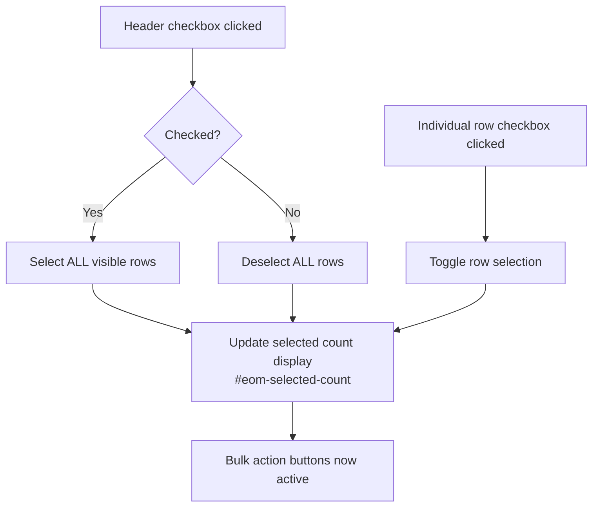

### 4.6 Inline Editing

Users can edit order fields directly without leaving the dashboard.

**Editable Fields (15 total):**

| Field | Input Type | Setter Method |
|---|---|---|
| `billing_first_name` | Text | `set_billing_first_name()` |
| `billing_last_name` | Text | `set_billing_last_name()` |
| `billing_phone` | Text | `set_billing_phone()` |
| `billing_email` | Text | `set_billing_email()` |
| `billing_address_1` | Text | `set_billing_address_1()` |
| `billing_address_2` | Text | `set_billing_address_2()` |
| `billing_city` | Text | `set_billing_city()` |
| `billing_state` | Text | `set_billing_state()` |
| `billing_postcode` | Text | `set_billing_postcode()` |
| `shipping_address_1` | Text | `set_shipping_address_1()` |
| `shipping_address_2` | Text | `set_shipping_address_2()` |
| `shipping_city` | Text | `set_shipping_city()` |
| `customer_note` | Textarea | `set_customer_note()` |
| `status` | Dropdown | `update_status()` |
| `assigned_staff` | Dropdown | Direct meta update |

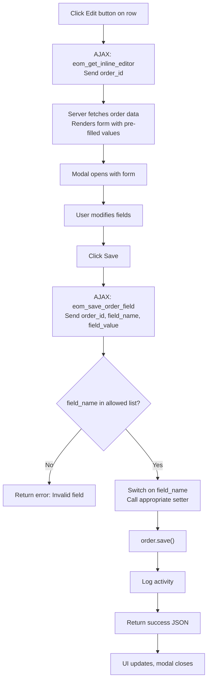

### 4.7 Bulk Actions System

Seven bulk operations available from the dropdown:

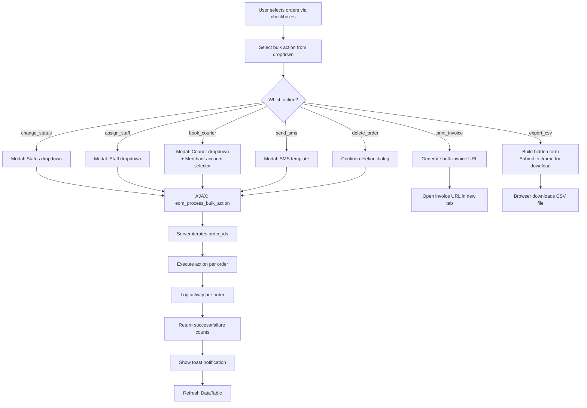

#### 4.7.1 Change Status (Bulk)
```
FOR each order_id in selected_ids:
    order = get_order(order_id)
    new_status = prepend "wc-" if absent
    order.update_status(new_status)
    log_activity(order_id, "Status changed to {status}")
```

#### 4.7.2 Assign Staff (Bulk)
```
FOR each order_id in selected_ids:
    update_meta(order_id, "eom_assigned_staff", staff_user_id)
    log_activity(order_id, "Assigned to {staff_name}")
```

#### 4.7.3 Book Courier (Bulk)
```
courier_slug = selected_courier
merchant_id = selected_merchant (can be per-order JSON mapping)

courier = CourierManager.get_courier(courier_slug)
VALIDATE courier is configured

FOR each order_id in selected_ids:
    order_data = prepare_order_data(order)  // Normalize names, phone, address, weight, COD
    result = courier.book_parcel(order_data)
    IF success:
        save_booking(order_id, result)  // DB + order meta
        success_count++
    ELSE:
        failure_count++

RETURN "{success_count} booked, {failure_count} failed"
```

#### 4.7.4 Export CSV (Bulk)
Streams a CSV file with these columns: `order_id, date, customer_name, phone, email, address, products, quantity, total, payment_method, status, courier, tracking_id, staff, notes`

#### 4.7.5 Delete Order (Bulk)
```
FOR each order_id in selected_ids:
    log_activity(order_id, "Order deleted")
    permanently_delete(order_id)
```

### 4.8 Live Steadfast Status Refresh

Two modes: **Single order** and **Bulk refresh all**.

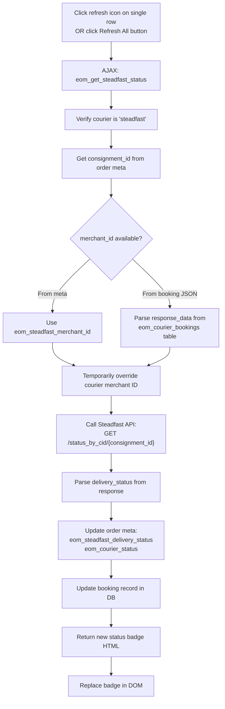

### 4.9 Customer Stats Quick View

Clicking the **Stats** button on any row opens a modal with customer fraud/risk analysis.

*(See Section 7 for full details)*

### 4.10 Steadfast XLSX Import UI

An expandable accordion section in the dashboard for importing courier data from Excel files.

*(See Section 17 for full details)*

---

## 5. PAGE: Inventory Management

### 5.1 Product & Cost Table

Displays all WooCommerce products with stock and cost information.

**Table Columns:**

| Column | Editable | Description |
|---|---|---|
| Product Name | ❌ | Product title |
| SKU | ❌ | Product SKU |
| Stock Qty | ❌ | Current stock (WC managed) |
| Stock Status | ❌ | In Stock / Low Stock / Out of Stock |
| Product Cost | ✅ (AJAX) | Per-unit cost (meta: `_eom_product_cost`) |
| Packaging Cost | ✅ (AJAX) | Per-unit packaging cost (meta: `_eom_packaging_cost`) |
| Total Value | ❌ | `stock_qty × product_cost` |

**Visual Indicators:**
- 🟢 **In Stock**: qty > low_stock_threshold
- 🟡 **Low Stock**: 0 < qty <= low_stock_threshold (CSS class: `eom-low-stock`)
- 🔴 **Out of Stock**: qty = 0 (CSS class: `eom-out-of-stock`)

### 5.2 Inline Cost Editing

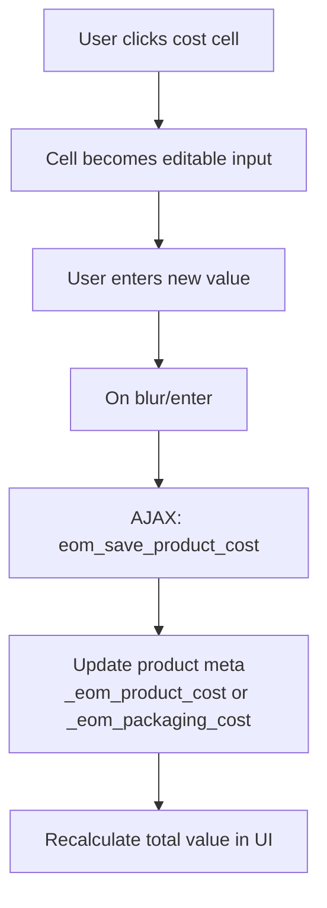

### 5.3 Automatic Stock Deduction

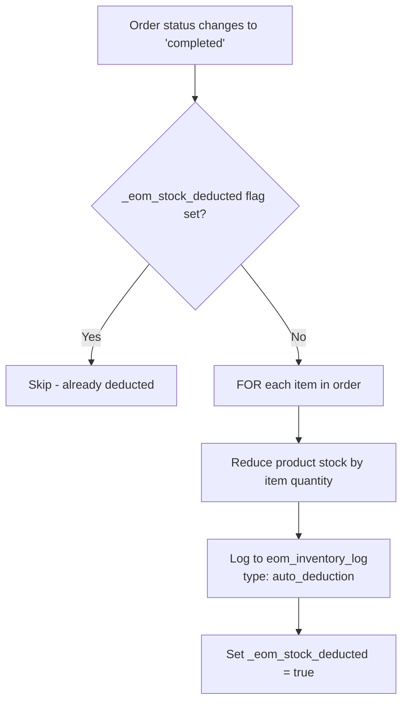

### 5.4 Low Stock Alerts (Weekly Cron)

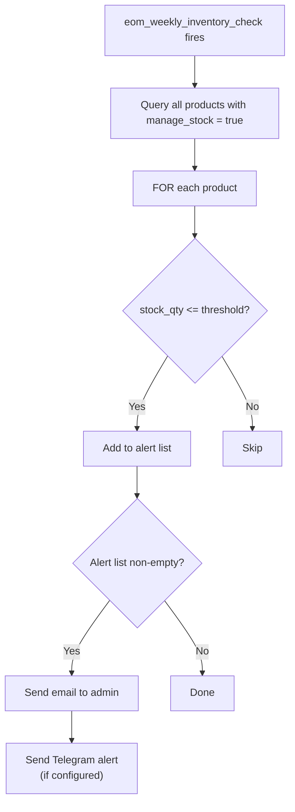

### 5.5 Total Inventory Value

```
total_value = 0
FOR each product WHERE manage_stock = true:
    cost = product._eom_product_cost OR 0
    total_value += product.stock_quantity × cost
DISPLAY total_value
```

---

## 6. PAGE: Profit & Loss Analytics

### 6.1 Order Status Classification

| Category | Statuses | Treatment |
|---|---|---|
| **Actual Revenue** | `confirmed`, `processing`, `completed` | Counted as real revenue |
| **Projected Revenue** | `on-hold` | Shown separately as potential |
| **Loss** | `returned`, `returned-charge` | Counted as losses |
| **Ignored** | `cancelled`, all others | Not counted |

### 6.2 Profit Calculation Formula

```
Revenue       = Order Total - Refund Amount
Product Cost  = SUM(item._eom_product_cost × item.quantity)  for all items
Packaging     = SUM(item._eom_packaging_cost × item.quantity) for all items
Combined Cost = Product Cost + Packaging Cost
Del. Charge   = eom_courier_charge  (fallback: WC shipping total)
COD Charge    = 1% × SUM(item.line_total)  [product revenue only]
Gateway Fee   = (configured percentage) × Revenue
Ad Cost       = (configured amount)

PROFIT = Revenue - Combined Cost - Del. Charge - Gateway Fee - COD Charge - Ad Cost
MARGIN = (Profit / Revenue) × 100
```

### 6.3 Return Loss Calculation

```
IF status == "returned":
    loss = full_delivery_charge + packaging_cost
    
IF status == "returned-charge":
    customer_paid = IF delivery_charge > 100 THEN 100 ELSE 60
    loss = (delivery_charge - customer_paid) + packaging_cost
```

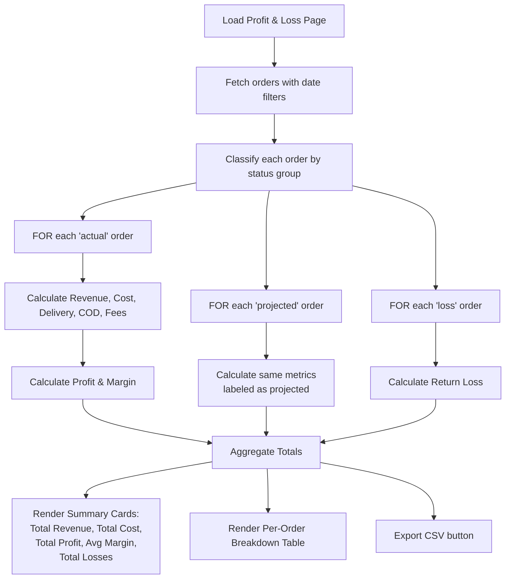

### 6.4 Summary Cards Display

| Card | Value | Visual |
|---|---|---|
| Total Revenue | Sum of all actual revenue | Green if positive |
| Total Cost | Sum of all costs | Neutral |
| Total Profit | Revenue - all costs | Green/Red based on sign |
| Average Margin | Mean of all margins | Percentage |
| Total Losses | Sum of return losses | Red |
| Projected Revenue | Sum of on-hold orders | Purple/muted |

### 6.5 CSV Export
- AJAX endpoint: `eom_export_profit_loss`
- Exports all calculated fields per order in CSV format

---

## 7. PAGE: Customer Stats & Fraud Detection

### 7.1 Customer Profile Assembly

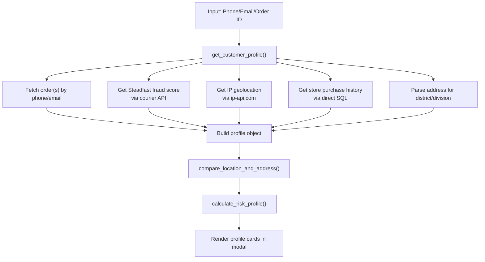

### 7.2 Bangladesh District Parser

- Contains a dictionary of all **64 districts** with common synonyms/alternate spellings
- Multi-pass regex matching extracts district and division from raw address text
- Handles variations like "Dhaka", "Dacca", "ঢাকা", etc.

### 7.3 IP Geolocation Analysis

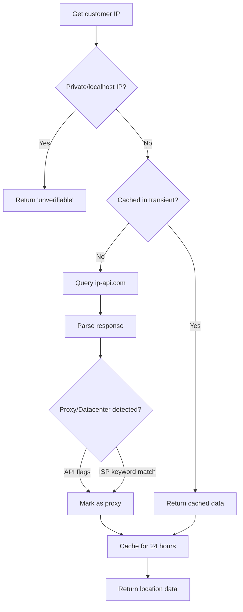

**Proxy/Datacenter Detection Keywords**: AWS, DigitalOcean, Google Cloud, Azure, Linode, Vultr, OVH, Hetzner

### 7.4 Location Comparison Logic

```
FUNCTION compare_location_and_address(ip_location, parsed_address):
    IF ip_location.country != "Bangladesh":
        RETURN "foreign" (DANGER)
    IF ip_location.is_proxy:
        RETURN "proxy" (DANGER)
    IF ip_location.city MATCHES parsed_address.district:
        RETURN "match" (SAFE)
    IF ip_location.city MATCHES parsed_address.division:
        RETURN "warning" (PARTIAL MATCH)
    RETURN "unverified"
```

### 7.5 Fraud Risk Scoring Algorithm

> [!CAUTION]
> This is a critical business logic algorithm. The risk percentage directly affects order processing decisions.

```
FUNCTION calculate_risk_profile(courier_data, store_history, location):
    base_probability = 12%
    
    // BLOCKED CHECK
    IF customer is blocked:
        RETURN 100% "Extreme"
    
    // COURIER DATA (Steadfast fraud check)
    IF courier_data.total_orders >= 21:  // High volume
        base = courier_data.cancellation_ratio  // Direct from courier
    ELSE IF courier_data.total_orders >= 6:  // Medium volume
        base = 80% × courier_data.cancellation_ratio + 20% × 12%
    ELSE:  // Low volume or no data
        base = 50% × courier_data.cancellation_ratio + 50% × 12%
    
    // MERCHANT FRAUD REPORTS
    IF fraud_reports > 0:
        base += MIN(fraud_reports × 5%, 20%)
    
    // STORE HISTORY ADJUSTMENT
    IF store_history.successful_orders >= 2 AND store_history.returns == 0:
        base = base × 0.5  // Halve risk for trusted customers
    ELSE IF store_history.returns > 0:
        base += store_history.return_ratio × 15%
    
    // LOCATION ADJUSTMENT
    IF location_match == "foreign" OR "proxy":
        base += 25%
    ELSE IF location_match == "warning":
        base += 8%
    
    // CATEGORIZE
    RETURN:
        <= 15%  → "Low Risk"
        <= 35%  → "Moderate Risk"
        <= 65%  → "High Risk"
        > 65%   → "Extreme Risk"
```

### 7.6 AJAX Endpoints

| Endpoint | Input | Output |
|---|---|---|
| `eom_get_customer_stats` | phone/email/order_id | Full profile HTML cards |
| `eom_lookup_ip` | IP address | Geolocation JSON |
| `eom_refresh_fraud_check` | order_id | Refreshed fraud analysis |
| `eom_save_location_review` | order_id, status | Saves review status to meta |

---

## 8. PAGE: Courier Management & Settings

### 8.1 Courier Architecture

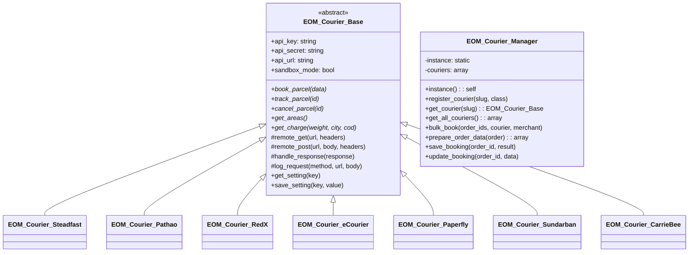

### 8.2 Order Data Preparation (Universal)

Before booking with any courier, order data is normalized:

```
FUNCTION prepare_order_data(wc_order):
    name = billing_first_name + " " + billing_last_name
    phone = sanitize_phone(billing_phone)
        // Steadfast: exactly 11 digits, strip +880, handle 0 prefix
    address = billing_address_1 + ", " + billing_city
    
    // Product description: first 5 items
    items = order.items[0:5].map(item => item.name + " × " + item.qty)
    description = items.join(", ")
    
    // Weight calculation
    weight = SUM(item.weight × item.qty) for all items
    IF weight == 0: weight = 0.5  // Default minimum 0.5 kg
    
    // COD amount
    IF payment_method == "cod":
        cod_amount = order.total
    ELSE:
        cod_amount = 0
    
    RETURN { name, phone, address, description, weight, cod_amount, order_id }
```

### 8.3 Courier Booking Flow

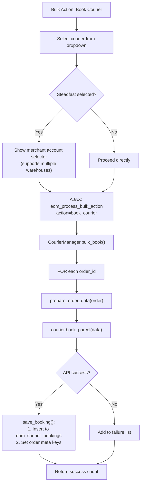

### 8.4 Per-Courier API Specifications

#### Steadfast

| Operation | Method | Endpoint | Key Fields |
|---|---|---|---|
| Book | POST | `/create_order` | `invoice`, `recipient_name`, `recipient_phone`, `recipient_address`, `cod_amount`, `note`, `item_description`, `weight` |
| Track | GET | `/status_by_cid/{id}` | Returns `delivery_status` |
| Cancel | POST | `/create_return_request` | `consignment_id` |
| Balance | GET | `/get_balance` | Returns account balance |
| Fraud | GET | `/fraud_check/score/{phone}` | Returns delivery/cancellation ratios |

**Auth**: `Api-Key` + `Secret-Key` headers. Supports **multiple merchant accounts**.

**Pricing**: Inside Dhaka: 60 BDT base + 10 BDT per 0.5kg extra. Outside Dhaka: 110 BDT base + 15 BDT per 0.5kg extra.

#### Pathao

| Operation | Method | Endpoint | Key Fields |
|---|---|---|---|
| Auth | POST | `/aladdin/api/v1/issue-token` | OAuth2 client_credentials + username/password |
| Book | POST | `/aladdin/api/v1/orders` | recipient info, area IDs, store ID, delivery_type, item_type, weight, COD |
| Track | GET | `/aladdin/api/v1/orders/{id}/tracking` | — |
| Cancel | POST | `/aladdin/api/v1/orders/{id}/cancel` | — |
| Areas | GET | `/aladdin/api/v1/cities` → `/zone-list` → `/area-list` | Hierarchical |
| Charge | POST | `/aladdin/api/v1/merchant/price-calculation` | — |
| Stores | GET | `/aladdin/api/v1/merchant/store` | — |

**Auth**: OAuth2 token (transient cached). Needs `client_id`, `client_secret`, `username`, `password`.

**Fallback Pricing**: 60 BDT base + 10 BDT per 0.5kg + 1.2% COD fee.

#### RedX

| Operation | Method | Endpoint | Key Fields |
|---|---|---|---|
| Auth | POST | `/auth/token` | Bearer token (transient cached) |
| Book | POST | `/parcels` | reference, customer_name/phone/address, area, weight, qty, pickup_store |
| Track | GET | `/parcels/{id}` | — |
| Cancel | POST | `/parcels/{id}/cancel` | — |
| Areas | GET | `/areas` | — |
| Charge | POST | `/pricing` | — |

**Fallback Pricing**: Inside Dhaka: 55 + 10/kg. Outside: 110 + 20/kg. COD: 1.5% (min 15 BDT).

#### eCourier

| Operation | Method | Endpoint | Key Fields |
|---|---|---|---|
| Auth | POST | `/login` | `api_key`, `api_secret`, `user_id` → Bearer token |
| Book | POST | `/parcels/create` | recipient details, city/thana, weight, quantities |
| Track | GET | `/parcels/{id}/status` | — |
| Cancel | POST | `/parcels/{id}/cancel` | — |
| Areas | GET | `/cities` → `/cities/{id}/thanas` | Hierarchical |
| Charge | POST | `/pricing/calculate` | — |

**Fallback Pricing**: 65 BDT base + 12 BDT per 0.5kg. COD: 1.2%.

#### Paperfly

| Operation | Method | Endpoint | Auth |
|---|---|---|---|
| Book | POST | `/parcels` | `X-Api-Key`, `X-Api-Secret` headers |
| Track | GET | `/parcels/{id}/track` | Same |
| Cancel | POST | `/parcels/{id}/cancel` | Same |
| Areas | GET | `/service-areas` | Same |
| Charge | POST | `/pricing/calculate` | Same |

**Fallback Pricing**: Inside Dhaka: 55 + 10 per 0.5kg. Outside: 100 + 15 per 0.5kg. COD: 1%.

#### Sundarban

| Operation | Method | Endpoint | Auth |
|---|---|---|---|
| Book | POST | `/orders/create` | `API-Key`, `API-Secret`, `X-Branch-Code` |
| Track | GET | `/orders/{id}/track` | Same |
| Cancel | POST | `/orders/{id}/cancel` | Same |

**Areas**: Hardcoded static dictionary of 64 Bangladesh districts.

**Pricing**: Inside Dhaka: 70 + 10/kg. Outside: 120 + 20/kg. COD: 1.2% (min 15 BDT).

#### CarrieBee

| Operation | Method | Endpoint | Auth |
|---|---|---|---|
| Book | POST | `/parcels` | `X-API-Key`, `X-API-Secret` |
| Track | GET | `/parcels/{id}/track` | Same |
| Cancel | POST | `/parcels/{id}/cancel` | Same |
| Areas | GET | `/service-areas` | Same |
| Charge | POST | `/pricing/calculate` | Same |

**Fallback Pricing**: Inside Dhaka: 50 + 10 per 0.5kg. Outside: 100 + 15 per 0.5kg. COD: 1%.

### 8.5 Courier Settings UI

A tabbed settings page for configuring each courier:

**Universal Fields per Courier:**
- API Key (with visibility toggle)
- API Secret (with visibility toggle)
- Sandbox Mode (toggle)
- Custom API URL (optional)

**Courier-Specific Extras:**
- **Pathao**: Client ID, Client Secret, Username, Password
- **eCourier**: User ID
- **Steadfast**: Multiple merchant account management + Live Fraud Check Tester

**Test Connection Feature:**
```
AJAX: eom_test_courier_connection
    → courier.get_areas() OR courier.check_balance()
    → IF success: "Connection successful ✓"
    → IF failure: "Connection failed: {error}"
```

---

## 9. PAGE: Team Management

### 9.1 Role Management

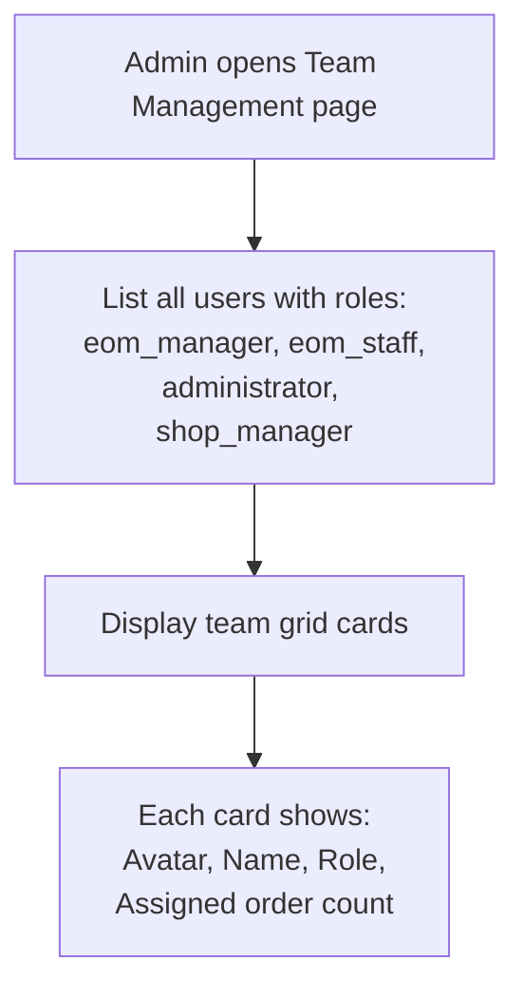

### 9.2 Staff Order Assignment

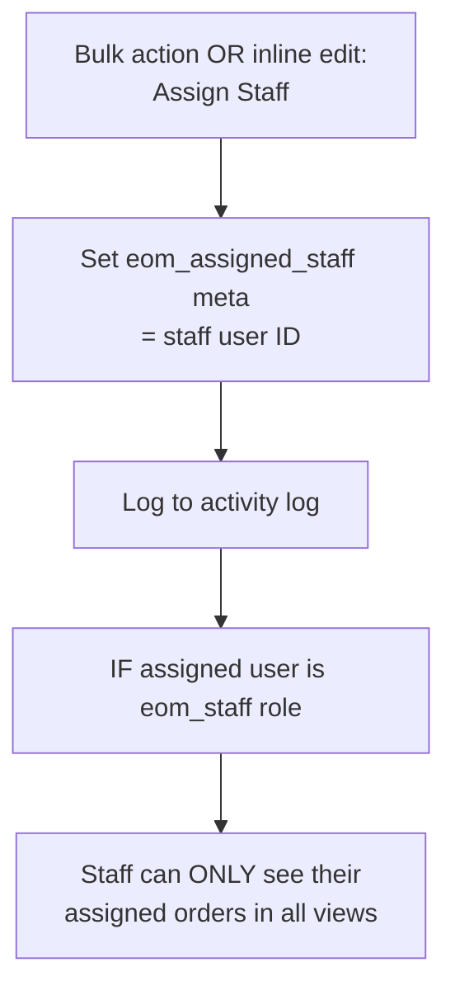

### 9.3 Staff View Restrictions

```
HOOK: pre_get_posts
IF current_user.role == "eom_staff":
    ADD meta_query:
        key = "eom_assigned_staff"
        value = current_user.ID
    // This filters ALL order queries system-wide
```

### 9.4 Activity Logging

Every significant action is logged to the `eom_activity_log` database table:

| Logged Actions |
|---|
| Status changes |
| Staff assignments |
| Courier bookings |
| Order edits (all fields) |
| Order deletions |
| Customer blocks/unblocks |
| Invoice prints |
| CSV exports |
| SMS sends |

---

## 10. PAGE: Delivery Charge Alerts

### 10.1 Discrepancy Detection

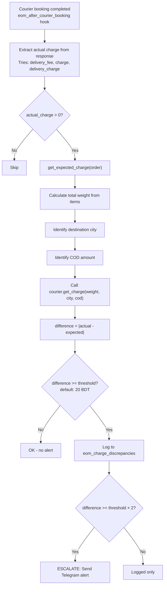

### 10.2 Daily Cron Sweep

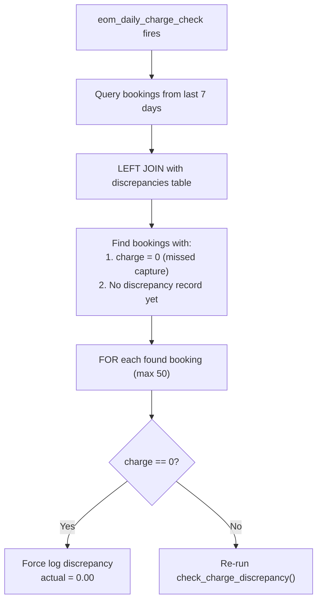

### 10.3 Alerts Page UI

| Tab | Shows |
|---|---|
| Open | Unreviewed discrepancies |
| Reviewed | Dismissed discrepancies |
| All | Everything |

**Table Columns**: Order ID, Courier, Expected, Actual, Difference (color-coded), Date, Status, Action (Mark Reviewed)

### 10.4 Telegram Alert Format

```
⚠️ Delivery Charge Discrepancy

Order: #{order_id}
Customer: {name}
Total: {total} BDT
Expected Charge: {expected} BDT
Actual Charge: {actual} BDT
Difference: {difference} BDT
Courier: {courier_name}
```

---

## 11. FEATURE: Invoice Generation & Printing

### 11.1 Invoice Content

| Section | Fields |
|---|---|
| Store Info | Store name, address, phone, email |
| Customer Info | Name, phone, email, shipping address |
| Itemized Table | Product name, quantity, unit price, line total |
| Totals | Subtotal, shipping, discount, tax, grand total |
| Barcode | SVG Code128 barcode of Order ID |
| Payment | Payment method |
| Notes | Customer note, order notes |

### 11.2 Generation Flow

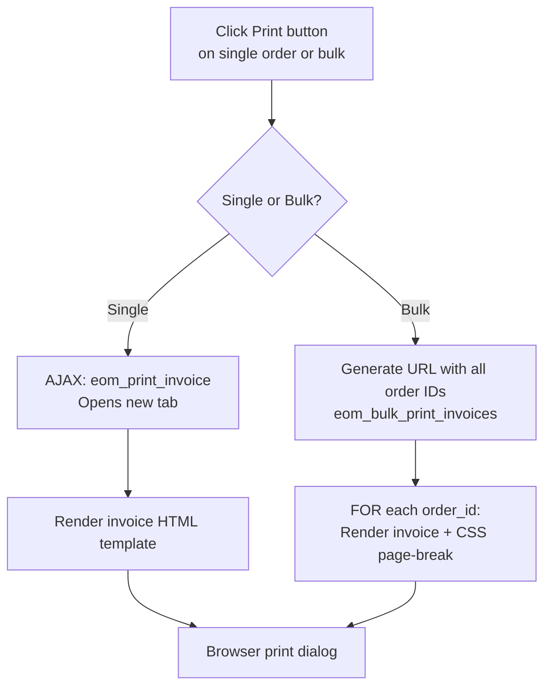

### 11.3 PDF Download

```
IF class Dompdf exists:
    Generate PDF via Dompdf → stream to browser
ELSE IF class mPDF exists:
    Generate PDF via mPDF → stream to browser  
ELSE:
    Force download as .html file
```

### 11.4 Barcode Generation

- Custom SVG Code128 barcode rendered inline
- No external libraries required
- Encodes the Order ID as a scannable barcode

---

## 12. FEATURE: Customer Order Tracking (Frontend)

### 12.1 Access Methods

1. **Shortcode**: `[eom_track_order]` — embeddable on any page
2. **My Account endpoint**: `/my-account/track-order/`

### 12.2 Tracking Flow

```mermaid
flowchart TD
    A["Customer enters Order ID + Phone"] --> B["AJAX: eom_lookup_tracking<br/>(supports non-logged-in users)"]
    B --> C["Sanitize phone number"]
    C --> D["Fetch order by ID"]
    D --> E{"Phone matches billing_phone?"}
    E -->|No| F["Error: Order not found"]
    E -->|Yes| G["Build tracking response"]
    G --> H["Render tracking template"]
```

### 12.3 Visual Progress Bar

Maps internal statuses to a **6-step visual progress bar**:

| Step | Label | Statuses That Reach This Step |
|---|---|---|
| 1 | Pending | All orders start here |
| 2 | Processing | `processing` and beyond |
| 3 | Confirmed | `confirmed` and beyond |
| 4 | Courier | `eom-awaiting-shipment` and beyond |
| 5 | In Transit | Courier status = `in_transit` |
| 6 | Delivered | `completed` or courier status = `delivered` |

### 12.4 Tracking Template Content

- Order summary (ID, date, total)
- Ordered items list
- Visual step progress bar
- Current status badge
- Direct courier tracking link (if available)

---

## 13. FEATURE: Google Sheets Integration

### 13.1 Authentication

```mermaid
flowchart TD
    A["Service Account JSON uploaded"] --> B["Extract private key + client email"]
    B --> C["Generate JWT token"]
    C --> D["Sign with RSA private key"]
    D --> E["Exchange JWT for Bearer token"]
    E --> F["Token cached in transient"]
```

### 13.2 Sync Mechanism

```mermaid
flowchart TD
    A["Auto-Sync Triggers"] --> B["woocommerce_new_order"]
    A --> C["woocommerce_order_status_changed"]
    A --> D["eom_after_courier_booking"]
    
    B --> E["Prepare row data"]
    C --> E
    D --> E
    
    E --> F["Google Sheets API v4"]
    F --> G{"Row exists for this order?"}
    G -->|No| H["Append new row"]
    G -->|Yes| I["Update existing row"]
```

### 13.3 Synced Columns

| Column | Source |
|---|---|
| Order ID | `order.id` |
| Date | `order.date_created` |
| Customer Name | Billing first + last name |
| Phone | `billing_phone` |
| Email | `billing_email` |
| Address | Full billing address |
| Products | Item names + quantities |
| Total | `order.total` |
| Payment Method | Payment method title |
| COD Amount | `order.total` if COD, else 0 |
| Status | Order status |
| Courier | `eom_courier_name` |
| Tracking ID | `eom_tracking_id` |
| Del. Charge | Live from `eom_courier_bookings` |
| COD Fee | Live from `eom_courier_bookings` |
| Staff | Assigned staff name |
| Profit/Loss | Calculated profit amount |

### 13.4 AJAX Endpoints

| Endpoint | Purpose |
|---|---|
| `eom_gsheets_test` | Test connection to sheet |
| `eom_gsheets_sync` | Manual full sync all orders |
| `eom_gsheets_sync_selected` | Sync specific order IDs |

---

## 14. FEATURE: Return Minimizer Automation

### 14.1 Purpose

When a parcel is returned by the courier, the system automatically suggests existing customers who might buy the same/similar products, minimizing the loss.

### 14.2 Flow

```mermaid
flowchart TD
    A["System identifies returned orders<br/>(last 30 days)"] --> B["Query eom_courier_bookings<br/>statuses: returned, cancelled,<br/>return_to_merchant, hold"]
    B --> C["FOR each returned order"]
    C --> D["Get product(s) in that order"]
    D --> E["Query orders from last 90 days<br/>EXCLUDING original customer"]
    E --> F["Score matching customers"]
    F --> G{"Scoring Rules"}
    G --> H["+10 points: Exact product match<br/>(previously bought same product)"]
    G --> I["+5 points: Category match<br/>(bought from same category)"]
    F --> J["Sort by score DESC"]
    J --> K["Return top 10 suggestions"]
    K --> L["Render suggestion chips in UI"]
    L --> M["User clicks a suggestion"]
    M --> N["AJAX: eom_reassign_parcel"]
    N --> O["Create duplicate order<br/>with new customer details"]
```

### 14.3 AJAX Endpoints

| Endpoint | Input | Output |
|---|---|---|
| `eom_get_suggestions` | Returned order ID | Top 10 customer suggestions with scores |
| `eom_reassign_parcel` | Original order ID + customer ID | New order created |

---

## 15. FEATURE: Urgent Order Monitoring

### 15.1 Detection Criteria

```
QUERY eom_courier_bookings WHERE:
    status NOT IN ('delivered', 'cancelled', 'returned')
    AND updated_at < NOW() - threshold_days (default: 7)
```

### 15.2 Flow

```mermaid
flowchart TD
    A["Daily cron: eom_daily_urgent_check"] --> B["Query stalled bookings"]
    B --> C["FOR each stalled order"]
    C --> D["Build alert data"]
    D --> E{"Auto-alert enabled?"}
    E -->|Yes| F["Send Telegram alert automatically"]
    E -->|No| G["Queue for admin review"]
    
    H["Admin opens Urgent Orders page"] --> I["View list of stalled orders"]
    I --> J["Action: Send Alert manually"]
    I --> K["Action: Dismiss"]
    J --> L["Telegram notification sent"]
    K --> M["Remove from urgent list"]
```

### 15.3 Telegram Alert Content

```
🚨 Urgent Order Alert

Order: #{order_id}
Amount: {total} BDT
Courier: {courier_name}
Tracking: {tracking_id}
Last Updated: {updated_at}
Days Stalled: {days_count}
```

---

## 16. FEATURE: Customer Blocking

### 16.1 Block Flow

```mermaid
flowchart TD
    A["Admin clicks Block button<br/>on order row"] --> B["Confirmation dialog"]
    B --> C["AJAX: eom_block_customer"]
    C --> D["Extract phone + email from order"]
    D --> E["Sanitize:<br/>Phone: strip non-numeric<br/>Email: lowercase"]
    E --> F{"Already in blocklist?"}
    F -->|Yes| G["Skip duplicate"]
    F -->|No| H["Add to eom_blocked_customers option"]
    H --> I["Set _eom_customer_blocked meta on order"]
    I --> J["Button changes to 'Blocked' state"]
```

### 16.2 Checkout Validation

```mermaid
flowchart TD
    A["Customer submits checkout"] --> B["Hook: woocommerce_checkout_process"]
    B --> C["Get billing phone + email"]
    C --> D["Sanitize values"]
    D --> E["Check against eom_blocked_customers"]
    E --> F{"Match found?"}
    F -->|Yes| G["wc_add_notice() → Error<br/>Block order placement"]
    F -->|No| H["Allow checkout to proceed"]
```

### 16.3 Admin Blocklist Page

- Table showing all blocked customers (phone, email, date blocked)
- Unblock action per entry
- Accessible via `eom-blocked-customers` menu

---

## 17. FEATURE: Steadfast XLSX Import

### 17.1 Purpose

Import courier tracking data from Steadfast's Excel export files to bulk-update orders.

### 17.2 Import Flow

```mermaid
flowchart TD
    A["Expand import accordion on Dashboard"] --> B["Select .xlsx file"]
    B --> C["Submit via FormData<br/>AJAX: eom_import_steadfast_xlsx"]
    C --> D["Server opens XLSX<br/>using ZipArchive + SimpleXML"]
    D --> E["Parse rows from spreadsheet"]
    E --> F["FOR each row"]
    F --> G["MATCH to WooCommerce order"]
    
    G --> H{"Matching Priority"}
    H -->|1st| I["Match XLSX Order ID to<br/>eom_consignment_id or<br/>eom_tracking_id meta"]
    H -->|2nd| J["Intelligent string match:<br/>billing name + phone<br/>(handles 880 prefix variations)"]
    
    I --> K{"Match found?"}
    J --> K
    K -->|Yes| L["Update order meta:<br/>delivery_status, tracking_code,<br/>shipping_charge, cod_fee"]
    K -->|No| M["Mark as 'skipped/failed'"]
    
    L --> N["Update eom_courier_bookings table"]
    N --> O["Log to eom_activity_log"]
    
    O --> P["Render results table"]
    M --> P
    P --> Q["Show matched/skipped/failed counts"]
```

### 17.3 Updated Fields

| Field Updated | Source in XLSX |
|---|---|
| `eom_steadfast_delivery_status` | Delivery status column |
| `eom_tracking_id` | Tracking code column |
| `eom_courier_charge` | Shipping charge column |
| `eom_courier_cod_fee` | COD fee column |
| `eom_courier_status` | Delivery status column |

---

## 18. FEATURE: CSV Export

### 18.1 Export Modes

| Mode | Trigger | Data Source |
|---|---|---|
| **Selected Orders** | Bulk action on selected rows | Array of order IDs |
| **Filtered Orders** | Export button with active filters | Filter query parameters |

### 18.2 CSV Column Schema

| Column | Source |
|---|---|
| `order_id` | `order.id` |
| `date` | `order.date_created` (formatted) |
| `customer_name` | First + Last name |
| `phone` | `billing_phone` |
| `email` | `billing_email` |
| `address` | Full billing address concatenated |
| `products` | Product names with quantities |
| `quantity` | Total quantity (sum of all items) |
| `total` | `order.total` |
| `payment_method` | Payment method title |
| `status` | Order status label |
| `courier` | `eom_courier_name` |
| `tracking_id` | `eom_tracking_id` |
| `staff` | Assigned staff display name |
| `notes` | Customer note |

### 18.3 Quantity Calculation

```
total_qty = 0
FOR each item in order.items:
    total_qty += item.get_quantity()
```

---

## 19. Settings & Configuration

### 19.1 Plugin Options

| Option Key | Default | Description |
|---|---|---|
| `eom_low_stock_threshold` | `10` | Products below this count trigger alerts |
| `eom_charge_discrepancy_threshold` | `20` | Minimum BDT difference to flag |
| `eom_urgent_days_threshold` | `7` | Days before an order is "urgent" |
| `eom_urgent_auto_alert` | `false` | Auto-send Telegram for urgent orders |
| `eom_invoice_store_name` | Blog name | Store name on invoices |
| `eom_invoice_store_email` | Admin email | Store email on invoices |
| `eom_telegram_bot_token` | — | Telegram bot API token |
| `eom_telegram_chat_id` | — | Telegram chat/group ID for alerts |
| `eom_blocked_customers` | `[]` | Array of blocked phone/email records |
| `eom_gsheets_*` | — | Google Sheets service account config |
| `eom_courier_{slug}_*` | — | Per-courier API credentials |

### 19.2 Settings Tab Structure

The courier settings page uses a tabbed interface:

```
[Steadfast] [Pathao] [RedX] [eCourier] [Paperfly] [Sundarban] [CarrieBee]
```

Each tab contains:
1. API Key input (with show/hide toggle)
2. API Secret input (with show/hide toggle)
3. Sandbox Mode toggle
4. Custom API URL (optional)
5. Courier-specific fields
6. **Test Connection** button
7. Save button

---

## 20. Master Flowcharts

### 20.1 Complete Order Lifecycle

```mermaid
flowchart TD
    A["New Order Created<br/>(WooCommerce)"] --> B["Auto-sync to Google Sheets"]
    A --> C["Appears in Dashboard DataTable"]
    
    C --> D["Admin Reviews Order"]
    D --> E["Check Customer Stats/Fraud"]
    E --> F{"Risk Level?"}
    F -->|Extreme/High| G["Block Customer?"]
    F -->|Low/Moderate| H["Process Order"]
    
    G -->|Block| G1["Add to blocklist<br/>Future checkouts blocked"]
    G -->|Continue| H
    
    H --> I["Assign Staff<br/>(bulk or inline edit)"]
    I --> J["Edit Order Details<br/>(inline editing)"]
    J --> K["Change Status<br/>(processing → confirmed)"]
    
    K --> L["Book Courier<br/>(bulk action)"]
    L --> M["Courier API books parcel"]
    M --> N["Tracking ID + Consignment saved"]
    N --> O["Charge discrepancy check"]
    O --> P["Google Sheets updated"]
    
    N --> Q["Monitor Delivery"]
    Q --> R["Refresh Steadfast Status"]
    Q --> S["Import XLSX updates"]
    Q --> T["Daily urgent check"]
    
    R --> U{"Status?"}
    S --> U
    U -->|Delivered| V["Complete Order"]
    U -->|Returned| W["Return Minimizer activates"]
    U -->|Stalled| X["Urgent Alert triggered"]
    
    V --> Y["Stock auto-deducted"]
    V --> Z["Profit calculated"]
    
    W --> AA["Find alternative buyers"]
    AA --> AB["Create new order for returned item"]
    
    X --> AC["Telegram notification sent"]
```

### 20.2 Complete System Integration Map

```mermaid
flowchart LR
    subgraph Frontend
        FT["Customer Tracking Page"]
    end
    
    subgraph Dashboard["Dashboard Hub"]
        DT["Order DataTable"]
        FI["Filter System"]
        BA["Bulk Actions"]
        IE["Inline Edit"]
        SS["Status Summary"]
        SI["Steadfast Import"]
    end
    
    subgraph Analytics
        PL["Profit & Loss"]
        INV["Inventory"]
        CS["Customer Stats"]
    end
    
    subgraph Courier["Courier System"]
        CM["Courier Manager"]
        ST["Steadfast"]
        PA["Pathao"]
        RX["RedX"]
        EC["eCourier"]
        PF["Paperfly"]
        SB["Sundarban"]
        CB["CarrieBee"]
    end
    
    subgraph Automation
        RM["Return Minimizer"]
        UO["Urgent Orders"]
        CA["Charge Alerts"]
    end
    
    subgraph Integrations
        GS["Google Sheets"]
        TG["Telegram Alerts"]
        INV2["Invoice System"]
    end
    
    subgraph Admin
        TM["Team Management"]
        BC["Block Customer"]
        AL["Activity Log"]
        SET["Settings"]
    end
    
    DT --> CM
    BA --> CM
    CM --> ST & PA & RX & EC & PF & SB & CB
    CM --> CA
    CM --> GS
    DT --> IE
    DT --> CS
    DT --> INV2
    DT --> BC
    DT --> SI
    FI --> DT
    SS --> DT
    CA --> TG
    UO --> TG
    INV --> TG
    TM --> DT
    FT --> CM
```

### 20.3 Data Flow: Order Metadata

```mermaid
flowchart TD
    subgraph Order_Meta["Order Metadata Store"]
        M1["eom_courier_name"]
        M2["eom_tracking_id"]
        M3["eom_consignment_id"]
        M4["eom_courier_status"]
        M5["eom_courier_charge"]
        M6["eom_courier_cod_fee"]
        M7["eom_assigned_staff"]
        M8["eom_steadfast_delivery_status"]
        M9["eom_courier_tracking_url"]
        M10["eom_steadfast_merchant_id"]
        M11["_eom_customer_blocked"]
        M12["_eom_stock_deducted"]
        M13["eom_activity_log"]
        M14["eom_location_review_status"]
    end
    
    subgraph Writers["Who Writes"]
        W1["Courier Booking"] --> M1 & M2 & M3 & M4 & M5 & M6 & M9 & M10
        W2["Status Refresh"] --> M4 & M8
        W3["XLSX Import"] --> M2 & M4 & M5 & M6 & M8
        W4["Staff Assignment"] --> M7
        W5["Customer Block"] --> M11
        W6["Stock Deduction"] --> M12
        W7["All Actions"] --> M13
        W8["Location Review"] --> M14
    end
    
    subgraph Readers["Who Reads"]
        R1["Dashboard Table"] --> M1 & M2 & M3 & M5 & M6 & M7 & M8
        R2["Profit/Loss"] --> M5 & M6
        R3["Tracking Page"] --> M1 & M2 & M9
        R4["Google Sheets"] --> M1 & M2 & M5 & M6 & M7
        R5["Charge Alerts"] --> M5
        R6["Inventory"] --> M12
        R7["Customer Stats"] --> M11 & M14
    end
```

---

> [!TIP]
> **For any coding agent implementing this as a SaaS or Android app:**
> 1. Start with the **Database Schema** (Section 2) — create all tables and metadata structures
> 2. Implement **User Roles** (Section 3) — this controls everything
> 3. Build the **Courier Base Class** pattern (Section 8.1) — this is the most reusable architecture
> 4. Build the **Dashboard** (Section 4) — it's the central hub that connects everything
> 5. Wire in **Analytics** (Sections 5-7) — they read from the same data
> 6. Add **Automations** (Sections 14-17) — they run independently on cron/events
> 7. Finally add **Integrations** (Section 13) — Google Sheets, Telegram

---

*Document generated from exhaustive source code analysis of Easy Order Manager v1.x*
*Total classes analyzed: 22 | Total AJAX endpoints: 30+ | Total features: 50+*
